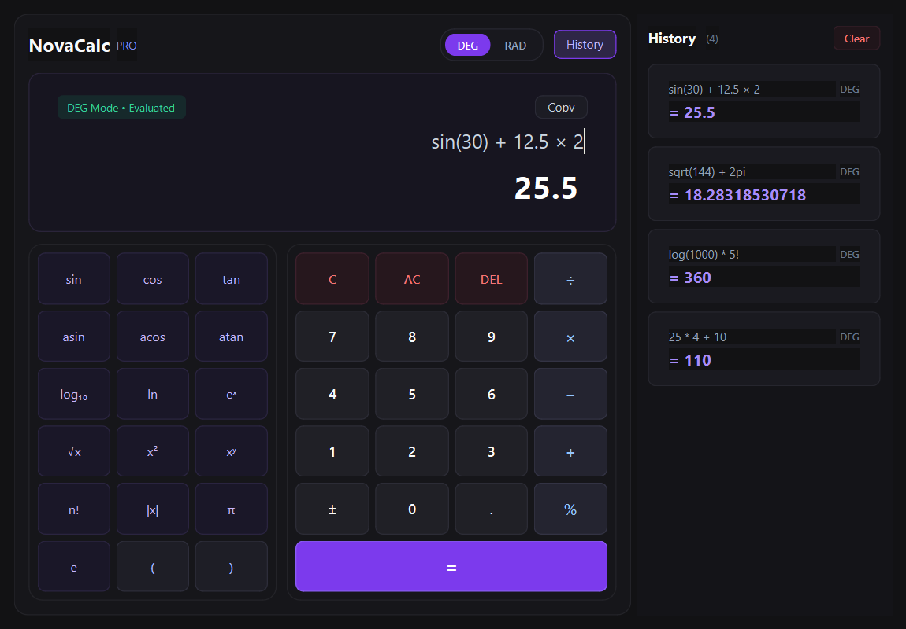

# NovaCalc — Modern Desktop Scientific Calculator

[](https://www.python.org/)
[](https://wiki.qt.io/Qt_for_Python)
[](https://pytest.org/)
[](https://www.microsoft.com/)
[](LICENSE)

**NovaCalc** is a high-precision, desktop scientific calculator developed with Python and **PySide6 (Qt6)**. Designed for engineering students, programmers, and STEM researchers, NovaCalc delivers accurate scientific computations through a modern dark-mode user interface, safe Abstract Syntax Tree (AST) expression parsing, dual trigonometric angle modes (DEG / RAD), and an interactive session history panel.

---

## 📸 User Interface Preview



---

## 🌟 Key Features

- **🎨 Modern Dark Aesthetic**: Crafted with custom Qt Style Sheets (QSS) featuring a deep charcoal canvas (`#121214`), vivid violet accents (`#7c3aed`), high-contrast typography, and smooth interactive micro-states.
- **⚡ Safe AST-Based Engine**: Built strictly without arbitrary `eval()`. Expressions are sanitized, checked against strict AST node whitelists, and evaluated safely in memory with bounded computational limits.
- **📐 Configurable Angle Modes (DEG / RAD)**: Instant toggle between Degree and Radian modes for all trigonometric (`sin`, `cos`, `tan`) and inverse-trigonometric (`asin`, `acos`, `atan`) functions with machine-epsilon correction for exact angles (e.g. $\sin(30^\circ) = 0.5$, $\cos(90^\circ) = 0$).
- **📜 Session Calculation History**: Dedicated collapsible history drawer displaying previous successful calculations. Click any entry to insert its result into the current expression, or double-click to restore the entire equation.
- **⌨️ Keyboard-First Workflow**: Direct editing through a custom expression input field (`QLineEdit`). Supports Enter (`=`) to evaluate, Esc to clear, Backspace/DEL, and Up/Down arrows to cycle previous expressions.
- **✨ Smart Mathematical Syntax**:
  - Implicit multiplication support: `2pi` $\rightarrow$ `2*pi`, `2(3+4)` $\rightarrow$ `2*(3+4)`, `3sin(30)` $\rightarrow$ `3*sin(30)`.
  - Natural factorial syntax: `5!` $\rightarrow$ `fact(5)`, `(2+3)!` $\rightarrow$ `fact(2+3)`.
  - Absolute value bars: `|-5| + 3` $\rightarrow$ `8`.
  - Square roots: `√144` or `sqrt(144)` $\rightarrow$ `12`.
  - Unicode mathematical operators: `×`, `÷`, `−`.
- **🛡️ Comprehensive Error Resilience**: Graceful error handling for division by zero, invalid logarithms, negative square roots, undefined tangent points, and syntax errors without crashing or wiping the active expression.
- **📦 Standalone Windows Executable**: Ready to distribute as a single self-contained `.exe` built with PyInstaller.

---

## 🧮 Mathematical Capabilities

### 1. Basic Arithmetic & Precedence
| Operation | Operator / Symbol | Example Expression | Output |
| :--- | :---: | :--- | :--- |
| Addition | `+` | `25 + 15` | `40` |
| Subtraction | `-` / `−` | `50 − 18` | `32` |
| Multiplication | `*` / `×` | `12 × 8` | `96` |
| Division | `/` / `÷` | `10 ÷ 4` | `2.5` |
| Modulo | `%` | `10 % 3` | `1` |
| Decimals | `.` | `0.1 + 0.2` | `0.3` |
| Precedence & Parentheses | `()`, `*`, `/`, `+`, `-` | `2 + 3 * 4` | `14` |

### 2. Scientific & Trigonometric Functions
| Category | Functions | Example | DEG Mode | RAD Mode |
| :--- | :--- | :--- | :--- | :--- |
| **Trigonometry** | `sin`, `cos`, `tan` | `sin(30)` | `0.5` | `-0.988031624093` |
| **Inverse Trig** | `asin`, `acos`, `atan` | `asin(0.5)` | `30` | `0.523598775598` |
| **Logarithms** | `log` (base 10), `ln` (natural) | `log(1000)` | `3` | `3` |
| **Powers & Roots** | `^`, `x²`, `xʸ`, `sqrt`, `√` | `sqrt(144) + 2^3` | `20` | `20` |
| **Exponential** | `exp`, `eˣ` | `exp(1)` | `2.718281828459` | `2.718281828459` |
| **Factorials** | `!`, `fact` | `5!` | `120` | `120` |
| **Absolute Value** | `\|x\|`, `abs` | `\|-12.5\|` | `12.5` | `12.5` |
| **Constants** | `pi` (`π`), `e` | `2pi` | `6.28318530718` | `6.28318530718` |

---

## 🏛️ Architecture & Project Structure

NovaCalc enforces a strict separation of concerns between presentation, mathematical evaluation, and data structures:

```text
NovaCalc/
├── main.py                     # Application entry point & Qt initialization
├── Calculator.py               # Root entry point alias (runs main.py)
├── requirements.txt            # Project dependencies (PySide6, pytest, Pillow)
├── build_exe.py                # Standalone Windows packaging script
├── README.md                   # Comprehensive documentation
├── core/                       # Mathematical engine & expression evaluation
│   ├── __init__.py             # Core package export
│   ├── engine.py               # CalculationEngine, AngleMode, result formatting
│   └── expression_parser.py    # Safe AST parser, symbol preprocessor, security whitelist
├── ui/                         # User Interface components (PySide6 / Qt6)
│   ├── __init__.py             # UI package export
│   ├── main_window.py          # Primary application window & signal routing
│   ├── display.py              # Editable expression QLineEdit & result display
│   ├── keypad.py               # Scientific and numeric button grids
│   └── history_panel.py        # Scrollable calculation history drawer
├── styles/                     # Visual design system
│   └── dark_theme.qss          # Modern dark theme Qt Style Sheet
├── assets/                     # Media & application icons
│   ├── icon.png                # High-res application icon (256x256)
│   ├── icon.ico                # Multi-resolution Windows executable icon
│   ├── screenshot.png          # High-resolution UI preview
│   └── generate_icon.py        # Automated vector-like icon generator (Pillow)
├── tests/                      # Automated test suite (pytest)
│   ├── __init__.py
│   ├── test_arithmetic.py      # Basic arithmetic & precedence test suite
│   ├── test_scientific.py      # Scientific functions & angle mode tests
│   ├── test_errors.py          # Boundary, domain error & security tests
│   └── test_ui_integration.py  # Headless Qt UI and signal integration tests
└── data/
    └── .gitkeep                # Session data directory placeholder
```

---

## 🔒 Security & Safe Expression Evaluation

Unlike basic calculators that evaluate raw input using `eval()`, NovaCalc implements a multi-layered security architecture:
1. **Preprocessor Sanitization**: Replaces mathematical symbols (`×`, `÷`, `−`, `π`, `^`, `!`) with canonical syntax while preserving scientific notation.
2. **AST Node Whitelist**: Traverses the Python Abstract Syntax Tree (`ast.walk`), allowing only `Expression`, `BinOp`, `UnaryOp`, `Call`, `Constant`, and `Name`.
3. **Execution Sandbox**: All statements, imports (`__import__`), file system access (`open`), attribute lookups (`__class__`), comprehensions, lambdas, and loops are rejected before evaluation.
4. **Computational Bounds**:
   - Exponentiation bounded to $|exponent| \le 10,000$ and base thresholds to prevent CPU freeze.
   - Factorial restricted to non-negative integers $\le 170$ ($170! \approx 7.257 \times 10^{306}$).

---

## 🚀 Getting Started

### Prerequisites
- **Windows 10 / 11**
- **Python 3.11+** installed (tested on Python 3.13)

### Installation

1. **Clone or download the repository**:
   ```bash
   git clone https://github.com/OPLUCIFER1405/Novocalc.git
   cd Novocalc
   ```

2. **Create and activate a virtual environment (optional but recommended)**:
   ```powershell
   python -m venv venv
   .\venv\Scripts\Activate.ps1
   ```

3. **Install dependencies**:
   ```bash
   pip install -r requirements.txt
   ```

4. **Launch the application**:
   ```bash
   python main.py
   # or
   python Calculator.py
   ```

---

## 🧪 Automated Testing

NovaCalc includes an automated test suite with **38 test cases** covering arithmetic, trigonometry, logs, boundary conditions, malicious payloads, and Qt UI integration.

Run the entire test suite with:
```bash
python -m pytest -v
```

### Test Coverage Highlights
- `test_arithmetic.py`: Precedence, float rounding (`0.1 + 0.2 = 0.3`), modulo, implicit multiplication.
- `test_scientific.py`: Trig in DEG & RAD, inverse trig, natural & base-10 log, roots, powers, factorials.
- `test_errors.py`: Division by zero, negative square root, $\tan(90^\circ)$ undefined, security rejection of `__import__`, overflow boundaries.
- `test_ui_integration.py`: Headless Qt window interactions, keypad inserts, sign toggling, history drawer clearing and navigation.

---

## 📦 Building the Standalone Windows Executable

To compile NovaCalc into a single standalone `.exe` without requiring Python to be installed on target machines:

```bash
python build_exe.py
```

The generated executable will be placed in `dist/NovaCalc.exe`.

---

## ⌨️ Keyboard Shortcuts Reference

| Shortcut | Action |
| :--- | :--- |
| `Enter` or `=` | Calculate current expression |
| `Escape` | Clear expression |
| `Backspace` / `DEL` | Delete previous character |
| `Up Arrow` ($\uparrow$) | Recall previous expression from history |
| `Down Arrow` ($\downarrow$) | Recall next expression from history |
| `0-9`, `.`, `+`, `-`, `*`, `/`, `%` | Direct character input |
| `(`, `)` | Parentheses |

---

## 📄 License

This project is licensed under the MIT License — see the [LICENSE](LICENSE) file for details.
